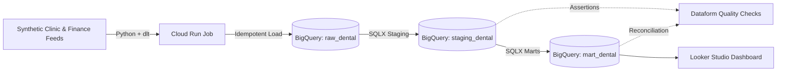
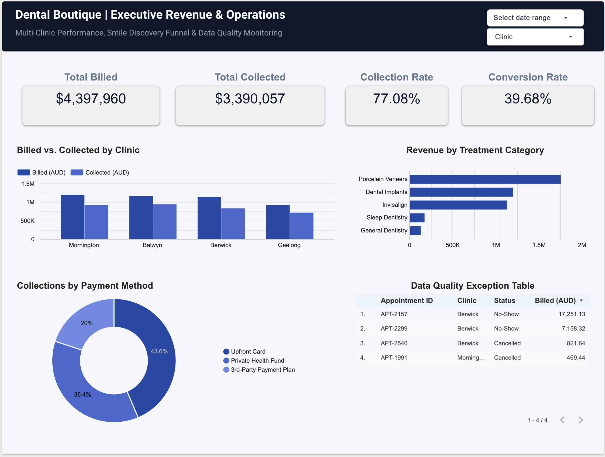
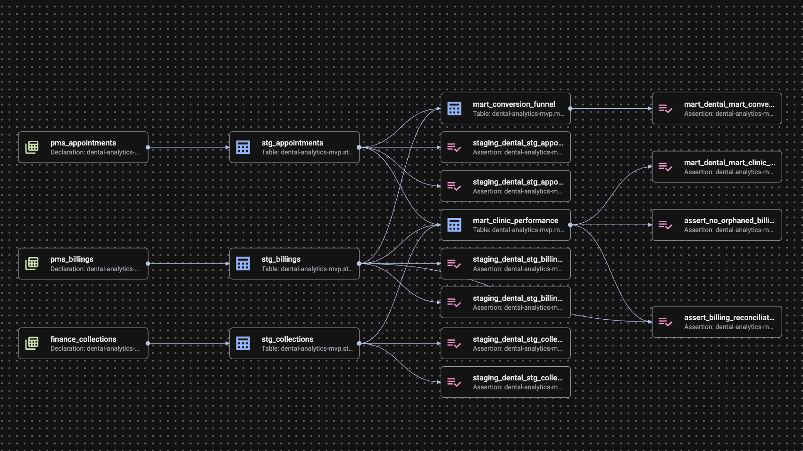
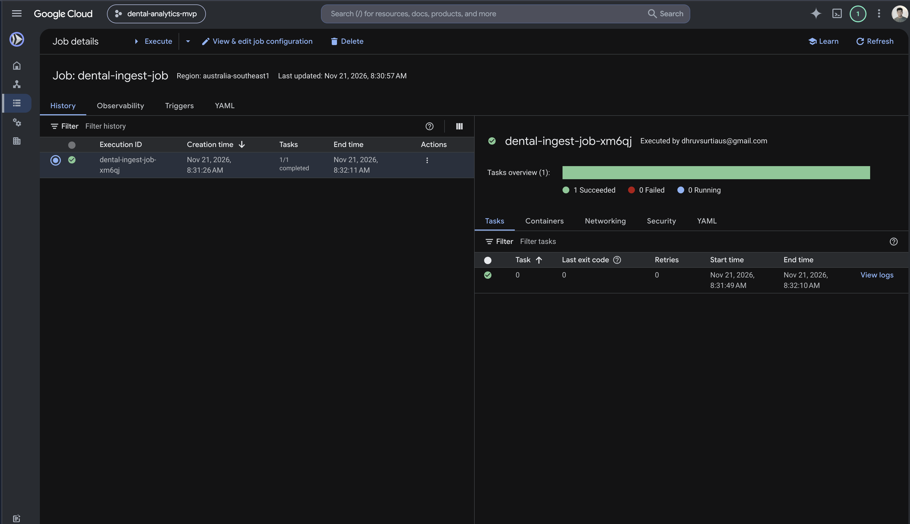

# Multi-Clinic Dental Analytics & Revenue Platform (GCP)


An end-to-end, serverless cloud analytics platform built on Google Cloud Platform (GCP) in the Sydney (`australia-southeast1`) region. Modelled on the operational and financial workflows of a multi-clinic Australian dental group, this pipeline ingests raw practice management and finance data, models core business metrics (appointments, Smile Discovery conversions, billings, and payment-plan collections), enforces automated data quality assertions, and serves an executive Looker Studio dashboard.

**Live Looker Studio Dashboard:** [https://datastudio.google.com/s/tf1qJ4EBEkY]

---

## Architecture Overview



| Layer | Technology | Purpose |
| :--- | :--- | :--- |
| **Ingestion** | Python, `dlt` | Extracts raw JSON feeds (`pms_appointments`, `pms_billings`, `finance_collections`) with idempotent `replace` loads |
| **Compute & Packaging** | Docker, Artifact Registry, Cloud Run Jobs | Serverless container execution in `australia-southeast1` using a dedicated least-privilege Service Account |
| **Data Warehouse** | Google BigQuery | Centralized storage split into `raw_dental`, `staging_dental`, and `mart_dental` datasets |
| **Transformation & Testing** | Google Cloud Dataform (SQLX) | Layered SQL modelling, deduplication, metric standardization, and 10 automated data quality assertions |
| **Business Intelligence** | Looker Studio | Interactive executive dashboard tracking clinic revenue, conversion rates, payment methods, and billing exceptions |

---

## Platform Visuals

### 1. Executive Revenue & Operations Dashboard (Looker Studio)
Tracks total billings vs. collections, collection rate, 30-day Smile Discovery Session conversion rate, treatment mix, payment method splits, and live data quality exceptions across Balwyn, Mornington, Geelong, and Berwick.



### 2. Dataform Dependency Graph (DAG)
Shows the complete lineage from raw BigQuery declarations through cleaned staging tables, business marts, and automated assertions.



### 3. Serverless Cloud Run Job Execution
Confirms the containerized `dlt` pipeline running cleanly on demand in Google Cloud without local credential files.



---

## Data Quality & Automated Testing

To simulate real-world multi-clinic data issues, `src/generate_data.py` intentionally injects four common operational bugs. Dataform handles these systematically before data reaches reporting:

1. **Duplicate Appointment Syncs:** Resolved in `stg_appointments` using `QUALIFY ROW_NUMBER() OVER (PARTITION BY appointment_id ORDER BY appointment_date DESC) = 1` and verified via built-in `uniqueKey` assertions.
2. **Inconsistent Clinic Naming:** Mixed casing and prefixes (e.g., `"DB Balwyn"`, `"balwyn"`, `"BALWYN "`) standardized into canonical clinic names across all staging models.
3. **Financial Reconciliation (`assert_billing_reconciliation`):** Custom SQLX assertion verifying that total billed revenue in `mart_clinic_performance` matches `stg_billings` to the cent, preventing join fan-out.
4. **Orphaned Billings (`assert_no_orphaned_billings`):** Custom SQLX assertion flagging `Cancelled` or `No-Show` appointments with non-zero billing amounts. These records are surfaced directly in the Looker Studio Data Quality Exception Table for clinic managers to audit.

---

## Repository Structure

```text
dental-analytics-mvp/
├── .dlt/
│   └── config.toml                 # Locks dlt BigQuery destination to australia-southeast1
├── screenshots/
│   ├── compiled-graph.png          # Dataform DAG lineage screenshot
│   ├── dashboard.png               # Looker Studio executive dashboard screenshot
│   └── dental-ingest-job.png       # Cloud Run Job execution screenshot
├── src/
│   ├── generate_data.py            # Generates 6 months of synthetic clinic, billing, and collection data
│   └── ingest_to_bq.py             # dlt pipeline loading raw JSON feeds into BigQuery
├── .dockerignore                   # Excludes local venv, raw data, and credentials from container builds
├── .gitignore                      # Keeps service account keys and local artifacts out of version control
├── Dockerfile                      # Python 3.11-slim container definition for Cloud Run Jobs
├── requirements.txt                # Python dependencies (dlt[bigquery])
└── README.md
```

---

## Security & Governance Practices

* **Data Residency:** All storage (BigQuery), compute (Cloud Run), and transformations (Dataform) are locked to `australia-southeast1` (Sydney).
* **Least-Privilege Access:** The Cloud Run Job runs under a dedicated `dlt-pipeline-runner` service account granted only `BigQuery Data Editor` and `BigQuery Job User` roles.
* **Zero Hardcoded Secrets:** Local service account keys are strictly excluded via `.gitignore` and `.dockerignore`; Cloud Run authenticates natively via Google-managed identity.

---

## Running Locally

```bash
# 1. Create and activate virtual environment
python3 -m venv venv
source venv/bin/activate
pip install -r requirements.txt

# 2. Generate synthetic clinic datasets
python src/generate_data.py

# 3. Authenticate with your local service account key and load to BigQuery
export GOOGLE_APPLICATION_CREDENTIALS="$(pwd)/gcp-key.json"
python src/ingest_to_bq.py
```
